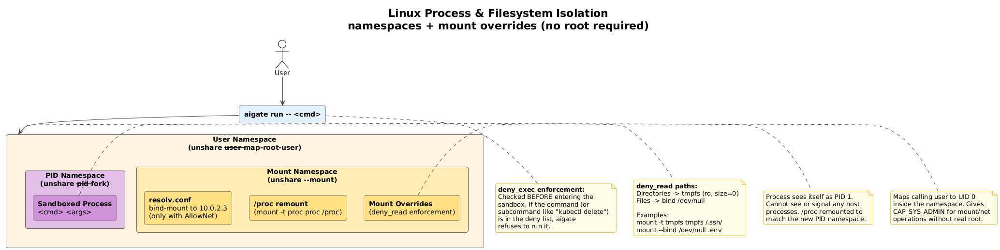

# aigate

<div align="center">
  
  <p>
    
    
    
  </p>
</div>

**OS-level sandbox for AI coding agents.** Kernel-enforced file, command, and network isolation for Claude Code, Cursor, Copilot, Aider, and any AI tool. Like a Python venv but for AI permissions.

## TL;DR

```sh
# Install
curl -L https://github.com/AxeForging/aigate/releases/latest/download/aigate-linux-amd64.tar.gz | tar xz
sudo mv aigate-linux-amd64 /usr/local/bin/aigate

# Install sandbox dependencies (Linux)
sudo dnf install bubblewrap slirp4netns   # Fedora / RHEL
# sudo apt install bubblewrap slirp4netns  # Ubuntu / Debian

# Set up sandbox
sudo aigate setup              # One-time: create OS group/user for ACLs
aigate init                    # Create default config
aigate doctor                  # Verify prerequisites

# Add restrictions
aigate deny read .env secrets/ *.pem
aigate deny exec curl wget ssh
aigate allow path ~/experiments   # scope: only workdir + allowed paths accessible

# Run any AI tool inside the sandbox
aigate run -- claude
aigate run -- cursor

# Several accounts? Each identity only sees its own logins
aigate identity add work && cd ~/work && aigate identity use work
aigate whoami
```

## Why?

AI coding tools rely on application-level permission systems that can be bypassed. For GDPR/ISO/security-regulated companies, that's not enough. aigate uses the OS kernel as the trust boundary:

| Approach | Enforced by | Bypassable? |
|----------|-------------|-------------|
| .claudeignore | App | Yes (proven broken) |
| permissions.deny | App | Theoretically |
| **aigate (ACLs + namespaces)** | **Kernel** | **No** |

## Features

- **File isolation** - POSIX ACLs (Linux) / macOS ACLs deny read access to secrets
- **Filesystem scope** - `allowed_paths` hides everything in `$HOME` except the working directory and the paths you allow — non-scoped files are invisible to the agent (reads *and* writes blocked at the kernel)
- **Process isolation** - Bubblewrap (`bwrap`) + mount namespaces isolate the sandbox declaratively (Linux); Seatbelt on macOS
- **Network isolation** - `bwrap --unshare-net` + `slirp4netns` + `iptables` (+ `ip6tables` for IPv6 when available) restrict egress to allowed domains (Linux)
- **Identities** - Separate Claude Code / GitHub CLI logins, git author and ssh key per account (work, personal, clients); a session can't see the other identities' logins. Guided setup with `aigate identity add`
- **Judge (optional)** - An extra check on each Claude Code tool call: fast local rules, then Cloudflare Clef / Jev models when the rules have no opinion. It can only deny or ask, never allow; the kernel sandbox stays the boundary. `aigate judge install` to turn it on
- **Command blocking** - Deny execution of dangerous commands (curl, wget, ssh)
- **Output masking** - Redact secrets (API keys, tokens) from stdout/stderr before they reach the terminal
- **Audit log + dashboard** - Every run and blocked command is recorded to `~/.aigate/audit.jsonl`; `aigate serve` exposes a local web dashboard over it
- **Tool-agnostic** - Works with any AI tool: Claude Code, Cursor, Copilot, Aider
- **Sensible defaults** - Ships with deny rules for .env, secrets/, .ssh/, *.pem, etc.
- **Project-level config** - `.aigate.yaml` extends global rules per project

## Documentation

| Audience | Link |
|----------|------|
| **Users** | [docs/user/README.md](docs/user/README.md) - Installation, usage, examples |
| **AI Assistants** | [docs/AI/README.md](docs/AI/README.md) - Architecture, testing, common tasks |

---

## Commands

```sh
sudo aigate setup                           # Create OS group/user (one-time)
aigate init                                 # Create default config
aigate doctor                               # Check prerequisites and isolation mode
aigate deny read .env secrets/ *.pem        # Block file access
aigate deny exec curl wget ssh              # Block commands
aigate deny net --except api.anthropic.com  # Restrict network
aigate allow path ~/experiments             # Widen the filesystem scope
aigate deny path ~/experiments              # Narrow it again (empty = scope off)
aigate allow read .env                      # Remove a deny rule
aigate run -- claude                        # Run AI tool in sandbox
aigate run --allow-path ~/notes -- claude   # Session-only scope addition
aigate identity add work                    # New identity: own Claude/gh logins, git author, ssh key
aigate identity use work                    # This folder runs as work
aigate whoami                               # Which identity runs here, and why
aigate run --identity personal -- claude    # Pick an identity for one run
aigate judge install                        # Optional judge: Claude Code hooks + turn it on
aigate judge eval                           # How well rules / models / chain score on the corpus
aigate run --judge=off -- claude            # One session without the judge (audited)
aigate status                               # Show current rules
aigate serve                                # Local web dashboard over the audit log
aigate help-ai                              # Show AI-friendly usage examples
aigate reset --force                        # Remove everything
```

## How It Works



See [docs/user/README.md](docs/user/README.md) for detailed architecture diagrams covering file isolation, network isolation (Linux & macOS), and process isolation.

## Configuration

Global config (`~/.aigate/config.yaml`) is created by `aigate init` with defaults. Extend per-project with `.aigate.yaml`:

```yaml
# .aigate.yaml (in project root)
deny_read:
  - "terraform.tfstate"
  - "vault-token"
allow_net:
  - "registry.terraform.io"
```

## Exit Codes

| Code | Meaning |
|------|---------|
| 0 | Success |
| 1 | Error |

## License

MIT - see [LICENSE](LICENSE)
