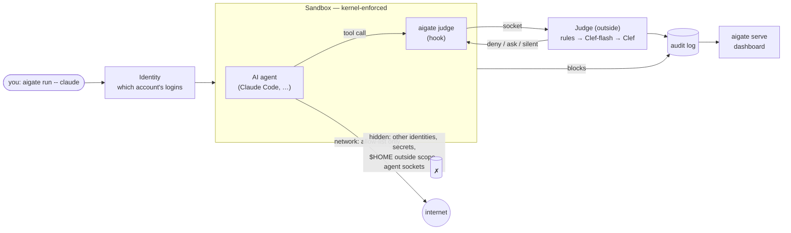

# aigate

<div align="center">
  
  <p>
    
    
    
  </p>
</div>

**OS-level sandbox for AI coding agents.** The kernel — not the AI tool — decides what Claude Code, Cursor, Copilot, Aider or any agent can read, run and reach. Like a Python venv, but for AI permissions.

## Quick start

```sh
# Install (Linux amd64; other builds on the releases page)
curl -L https://github.com/AxeForging/aigate/releases/latest/download/aigate-linux-amd64.tar.gz | tar xz
sudo mv aigate-linux-amd64 /usr/local/bin/aigate
sudo dnf install bubblewrap slirp4netns     # or: sudo apt install bubblewrap slirp4netns

aigate init                  # default config: secrets denied, $HOME scoped
aigate doctor                # READY / DEGRADED / BLOCKED, with the fix for each problem
aigate run -- claude         # run any AI tool inside the sandbox
```

Optional extras:

```sh
aigate identity add work && cd ~/work && aigate identity use work   # separate logins per account
aigate judge install         # extra check on each Claude Code tool call (deny/ask, never allow)
aigate serve                 # local dashboard: every block, verdict and override
```

## Why

App-level permissions (`.claudeignore`, `permissions.deny`) can be bypassed. aigate uses the OS kernel as the trust boundary — bubblewrap namespaces on Linux, Seatbelt on macOS — so a confused or prompt-injected agent can't talk its way past it.

## How it fits together



| Layer | What it does |
|---|---|
| **Sandbox** | Files outside the working dir and allowed paths are invisible; deny rules for secrets (`.env`, `~/.ssh`, `*.pem` …) and commands (`curl`, `ssh` …); egress limited to an allow-list; host agent/keyring sockets hidden. |
| **Identities** | One per account (work, personal, clients): its own Claude Code + GitHub CLI login, git author and ssh key. A session can't see the others. |
| **Judge** *(optional)* | Local rules in microseconds, then Cloudflare Clef / Jev models when rules have no opinion. Can only deny or ask; credentials and audit stay outside the sandbox. |
| **Masking + audit** | Secrets (Anthropic, OpenAI, GitHub, Cloudflare, AWS, Stripe …) redacted from output; every block, verdict and override recorded and shown in `aigate serve`. |

## Common commands

| Command | Does |
|---|---|
| `aigate run [--identity NAME] [--judge=off] -- CMD` | Run a tool in the sandbox |
| `aigate deny read\|exec\|net …` / `aigate allow …` | Change rules (`.aigate.yaml` per project) |
| `aigate identity add\|use\|list\|show\|remove`, `aigate whoami` | Manage identities |
| `aigate judge install\|uninstall\|eval\|allow-once ID` | Manage the judge |
| `aigate explain PATH` / `aigate explain -- CMD` | Would it be allowed here? Which layer decides, how to change it |
| `aigate doctor [--json\|--report]`, `aigate status`, `aigate serve` | Check, inspect, watch |

Everything else: `aigate --help`, `aigate help-ai`.

## Docs

- **Users** — [docs/user/README.md](docs/user/README.md): setup, every command, config, identities, judge, troubleshooting
- **AI assistants / contributors** — [docs/AI/README.md](docs/AI/README.md): architecture, design decisions, testing (`make test`, `make test-vm DISTRO=all`)

Tested on Fedora, Ubuntu, Debian, Arch, Rocky and macOS. MIT — see [LICENSE](LICENSE).
